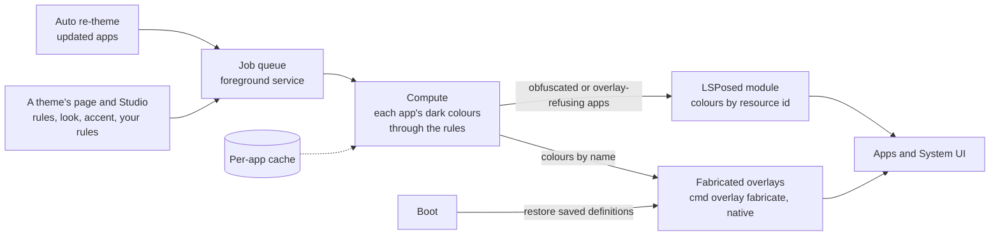

# Substratum Reborn

**A theme engine for One UI and AOSP, rebuilt on fabricated overlays and LSPosed, for themers to
build on.**

Substratum Reborn is the Substratum theme engine rebuilt for current Android, where overlay APKs
from a third party no longer load. Themers ship ordinary Substratum themes or *rules themes*;
the engine registers their colours as fabricated overlays with root and applies what an overlay
cannot reach through its LSPosed module. It is tested on One UI 9 (Galaxy A36, Android 17); the
same standard pieces make AOSP-based ROMs a target too, but they have not been tested yet.

Open **Themes** and every theme has its own page: a preview drawn with the engine's real colours,
the apps it changes on this phone, and **Apply**. The first built-in theme is **Reborn AMOLED**,
true black for every app; **Customize** opens its Studio, where you pick a look, compare it on a
live before and after preview and inspect every colour it changed in every app. **Create** holds
the tools for themers. Everything applied shows in one place, with one Undo.

<!--
  Screenshot slots. The images are not in the repository yet: they are captured in demo mode and
  reviewed by the owner first (docs/showcase/SHOTLIST.md lists the shots and the capture rules).
  TODO: uncomment once docs/showcase/themes.png, detail.png and studio.png are reviewed and added.

  
  
  

-->

## What it does

| Feature | What you get |
|---|---|
| **Themes** | Built-in themes first, then every installed theme as a full-width card (Reborn engine and classic), filters, search, install from an APK file. Each theme has its own page: a before/after preview, the apps it changes on this phone, Apply (with progress you can watch) and Customize |
| **Theme engine** | For themers: Reborn engine themes (rules, `assets/amoled/rules.json`) that read each app's own colours on the phone, so one theme fits every app, and classic Substratum themes; colours apply natively as fabricated overlays or through the LSPosed module (by resource id). The format is in [docs/oneui9/README.md](docs/oneui9/README.md) |
| **Reborn AMOLED** (built-in theme) | True black for every app; Customize opens its Studio |
| **Studio** | A theme's looks (Pure black, Elevated cards, Dim), a live before/after preview of Quick Settings and Settings drawn from the engine's computed colours, one-tap Apply |
| **Create** | Tools for themers: inspect any app's colours (resource names, values and the rule behind each), the resource names the previews read, and the theming guide |
| **Levels and accent** | Pure, Dim, Elevated or Tinted surfaces; accent none, Monet (the wallpaper's), One UI blue, white or any colour; optionally in light mode too |
| **Per-app inspector** | Every covered app with search, filters, its route (native overlay or module) and a *Restart needed* state; each colour that changed, stock to themed, and the rule that decided it; long-press to keep a colour stock, pin your own or copy its name |
| **Applied and Undo everything** | Compiled theme overlays, the engine theme and Quick Settings tweaks in one list; swipe one off, or put everything back to stock in one go |
| **Quick Settings designer** (One UI only) | Opaque shade, near-black slider tracks, the active tile colour and a compact row height, carried out in One UI 9's System UI by the module |
| **Classic** | Compatible legacy Substratum themes still work (their page's Choose overlays opens Classic's theme screen), and Classic Substratum is one tap away |
| **Safety** | A kill switch, a crash-loop guard for System UI and every hooked app, no restarts of the phone, Bluetooth or keyboard processes, boot restore, and snapshots on Remove |
| **Engine** | Fabricated overlays + LSPosed: cached, batched and flicker-free, and apps you update are re-themed on their own |

Measured on a Galaxy A36 with 229 apps: a first apply takes about 100 seconds, and a re-apply when
nothing changed a few seconds (the classic engine, still selectable, needs about four minutes).

## Requirements

- **Android 12 or newer** (shell fabricated overlays).
  - **Tested:** One UI 9 / Android 17 on a **Galaxy A36**.
  - **Targeted, not tested yet:** AOSP-based ROMs such as Pixel stock or LineageOS, rooted and
    with LSPosed. The engine uses only standard Android pieces, but nobody has run it on one of
    them so far.
  - **One UI only:** the Quick Settings designer and the One UI 9 design-token rules.
- **Root.** KernelSU is tested; Magisk and APatch should work but are untested.
- **LSPosed** with the Substratum Reborn module enabled. Its scope needs **System UI** and
  **Settings**, plus the apps the Studio marks *Needs scope* (Play Store and other Google apps,
  and apps that refuse overlays).

## Setup

1. Install the APK (`./gradlew :app:assembleDebug` builds `app/build/outputs/apk/debug/app-debug.apk`;
   it needs the Android SDK with platform 37.1 and a recent JDK).
2. Open Substratum Reborn and grant it root in your root manager (KernelSU is the tested one).
3. In LSPosed, enable the module and add System UI and Settings to its scope.
4. Follow the **Setup checklist** that opens on the first launch: four live checks (root, module,
   scope, System UI hooked), each with a Fix button, and unrestricted battery use as a
   recommendation so long applies finish with the screen off.
5. Open **Themes**, pick **Reborn AMOLED** (or any theme) and tap **Apply**. **Customize** opens
   its Studio for the look and Quick Settings. Apps marked *Needs scope* go into the module's
   scope; the Studio's app list filters them.

## How it works

- **Compute.** For every app the rules cover, the engine reads the dark-mode value each colour
  actually resolves to and decides what it becomes: surfaces go black (or to the level's step),
  text, icons, accents and light mode stay untouched.
- **Fabricated overlays (native).** Most colours are registered as night-only fabricated
  overlays with root. They are resolved by the system itself, apply live and need no overlay APK.
  Their definitions are kept in `/data/system/substratum` and registered again at every boot.
- **The LSPosed module (by id).** Apps with obfuscated resource names or that refuse shell
  overlays get their colours inside their own process, by resource id, keyed to the app version
  they were read from. On One UI 9 the module also draws what System UI paints in code (the
  Quick Settings shade, slider tracks, row height and the battery).
- **The cache and the auto re-theme job.** Each app's result is cached, so a re-apply only reads
  what changed; a periodic job re-themes apps after they update.

The engine, its files and the rules format are documented in
[docs/oneui9/README.md](docs/oneui9/README.md).

## If something goes wrong

Mildest first; none of these needs a reinstall.

1. **Pause hooks** (Home, Quick actions). The kill switch: the module installs no hooks anywhere
   and System UI restarts stock. **Resume hooks** brings everything back.
2. **Kill switch by hand**, from a root shell, if the app cannot open:
   `touch /data/resource-cache/substratum/hooks.off`, then restart System UI.
3. **Reset the crash-loop guard.** After repeated crashes the module leaves System UI (or an app)
   stock and Home shows *Guard tripped*; its Fix clears the guard and restarts System UI. By hand:
   `rm -f /data/user_de/0/com.android.systemui/reborn_guard_*`.
4. **Undo everything** (Home or Applied): the engine theme, theme overlays and Quick Settings
   tweaks back to stock, with a snapshot of the engine's colours kept.
5. **Disable the module** in LSPosed (Modules, Substratum Reborn off), then restart System UI.
6. **Full reboot**, the last resort: with temporary root, a full reboot drops root and LSPosed
   for that boot, so nothing of Reborn loads; set root up again afterwards.

The commands for each step are in [docs/oneui9/README.md#recovery](docs/oneui9/README.md#recovery).

## FAQ

**Why do the Play Store and Google apps need the module in their scope?**
Their resource names are obfuscated, or they refuse overlays from the shell, so no overlay can
reach their colours by name. The module applies them by resource id inside the app's own
process, and it can only do that in apps that are in its LSPosed scope.

**Why not overlay APKs, like classic Substratum?**
One UI 9 skips overlay APKs that Samsung did not preinstall, and Android limits what an overlay
signed with another key may change. Fabricated overlays, registered with root, are resolved
natively without an APK; the module covers what they cannot carry.

**Does it work on AOSP, a Pixel or LineageOS?**
That is the aim: fabricated overlays (Android 12 and newer) and an LSPosed module are standard
Android pieces, not Samsung ones. It has not been tested on a Pixel or another AOSP-based ROM
yet, so expect rough edges and report what you find. The Quick Settings designer and the One UI 9
design-token rules are One UI only; the Studio says so on other devices.

**Does it change light mode?**
No. Engine theme colours are night-only; where an app's light value is a fixed colour, the stock light
value is registered next to it, and the wallpaper (Monet) colours are never touched.

**What happens when an app updates?**
Its colours are keyed to the version they were read from, so an update never paints black text
on black: the app shows stock until the auto re-theme job reads it again, usually within the
hour, or at once from the Studio's *Re-apply changed apps only*.

**Will my old themes work?**
Compatible legacy Substratum themes install from their APK and apply through fabricated
overlays and the module. Reborn engine themes (rules) open their page in Themes; Customize opens
their Studio.

## Credits and licence

Substratum Reborn is based on [Substratum](https://github.com/substratum/substratum) by
Projekt Substratum, licensed under the GNU General Public License v3.0. Substratum Reborn is
free software under the same licence, version 3 or later: see [LICENSE.txt](LICENSE.txt). The
app lists the open-source libraries it uses, with their licences, under About.
