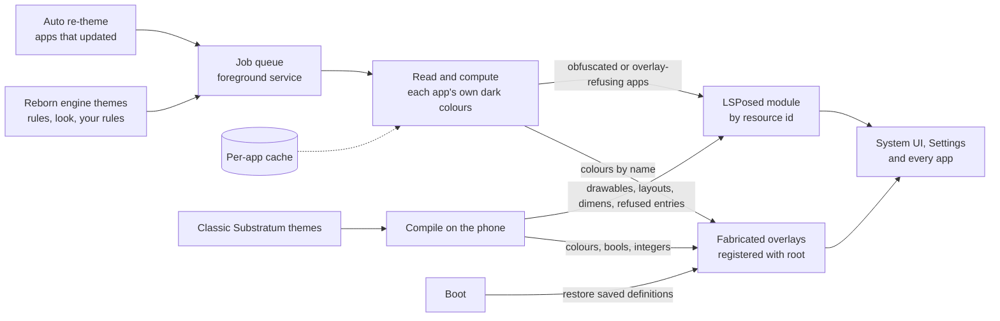

<div align="center">


# Reborn

<sub>Substratum</sub>

**Substratum, reborn for One UI and AOSP**

[](#requirements)
[](#requirements)
[](#does-it-work-on-aosp-a-pixel-or-lineageos)
[](LICENSE.txt)
[](#how-the-engine-works)

</div>

## What it is

Substratum Reborn is a theme engine first. It is the Substratum theme engine rebuilt for current
Android, where overlay APKs from a third party no longer load. Themes register their colours as
fabricated overlays with root, and Reborn's LSPosed module applies what an overlay cannot reach.

Themers can ship two kinds of theme, and both run on the same engine:

- **Classic Substratum themes**, compiled on the phone, as they always were.
- **Reborn engine themes**: a set of rules that reads each app's own colours on the phone, so one
  theme fits every app the user has.

**Reborn AMOLED**, true black for every app, is one of the built-in themes. The app itself is
built with Material 3 Expressive. It is tested on One UI 9 (Galaxy A36, Android 17); AOSP-based
ROMs are a target, but nobody has tested one yet.

## Screens

| Screen | What it shows |
|---|---|
| **Home** | The Now card: the theme in use, its look, how many apps it themes and the apps installed since the last apply. Re-apply, Customize and Undo sit under it, then other themes to try next and the way into Create. The status pill at the top opens the Engine screen. |
| **Themes** | Every theme as a compact card drawn in its own colours, the built-in ones first. Filters (All, Reborn, Classic, Built in), search, and Add: install a theme from a file, build your own, or open Classic. |
| **A theme's page** | A before and after preview against stock in each of the theme's looks, the apps it changes on this phone, its options, and Apply or Customize. |
| **Create** | For themers: the Studio, an inspector for any app's colours, the resource names the previews read, and the theming guide. |
| **Applied** | Everything applied, grouped by the app it changes: theme overlays, the engine theme and Quick Settings options. Swipe one off, or undo all. |
| **Engine** | Root, the LSPosed module and the System UI hooks in plain words, a fix for each problem, what the engine can do on this phone, quick actions and Rescue. |

<!--
  Screenshot slots. The images are not in the repository: they are captured on the test device by
  the rules in docs/showcase/SHOTLIST.md and reviewed by the owner before they are committed.
  Uncomment this block once the six files below are in docs/showcase/.

<p align="center">
  
  
  
</p>
<p align="center">
  
  
  
</p>
-->

## Features

| Feature | What you get |
|---|---|
| **Theme engine** | Classic Substratum themes compile on the phone and apply as fabricated overlays and through the module. Reborn engine themes (rules in `assets/amoled/rules.json`) read each app's own colours on the phone. One engine theme is on at a time; classic overlays stay on top of it. |
| **Themes** | Built-in themes first, then every installed theme in one grid, with filters and search. Install a theme APK from a file. Long-press a theme for App info, a home-screen shortcut, Turn off and Uninstall. |
| **Theme pages** | A before and after preview drawn from the theme's own colours, the apps it changes on this phone, Apply with progress you can watch, Customize and Remove. Classic themes list their parts, each with its own switch. |
| **Studio** | An engine theme's look: presets such as Pure black, Elevated cards and Dim, surfaces (Pure, Dim, Elevated, Tinted) and an accent (the app's own, Monet, One UI blue, white and more, or any colour; optionally in light mode too), over a live before and after preview of Quick Settings and Settings. |
| **Per-app inspector** | Every app the theme covers, with search, filters, its route (native or module) and a *Restart needed* state. Each colour it changed, stock to themed, and the rule that decided it. Long-press a colour to keep it stock, pin your own or copy its name. |
| **Quick Settings designer** (One UI only) | Opaque shade, near-black slider tracks, the active tile colour and a compact row height, carried out in One UI 9's System UI by the module. |
| **Create** | Tools for themers: inspect any app's colours, the preview roles, and the theming guide. |
| **Applied and Undo everything** | Theme overlays, the engine theme and Quick Settings options in one list, grouped by app. Swipe one off with Undo, or put everything back to stock in one go. |
| **Classic themes on One UI 9** | Dark mode only by default, so light mode stays stock. The compile drops only the lines this system no longer has; entries an overlay may not change go through the module. When a theme part crashes System UI, the Engine screen names it and offers to pause it. |
| **Engine screen** | The status, a fix for each problem, *Update ready* after Reborn updates, what the engine can do here, Restart System UI, Pause hooks, Soft reboot, the setup checklist, Undo everything and the Rescue shortcut. |
| **Auto re-theme** | Apps you update are read again on their own, about every hour. After a system update Reborn offers a full re-apply. |
| **Launcher shortcuts** | Themes, Create a theme, Applied and Rescue Me!, plus Customize for the engine theme in use. |
| **Classic Substratum** | The original Substratum screens are one tap away, from Home's menu or Themes' Add. |

Measured on a Galaxy A36 with 229 apps: a first apply of Reborn AMOLED takes about 100 seconds, and
a re-apply when nothing changed takes a few seconds.

## How the engine works



- **Compute.** For every app an engine theme covers, the engine reads the dark-mode value each
  colour actually resolves to and decides what it becomes: surfaces go black (or to the look's
  step), while text, icons and light mode stay untouched, and accents too unless the look picks
  one.
- **Compile.** A classic theme is built on the phone, as Substratum always did. When a line
  refers to something this system no longer has, only that line goes.
- **Fabricated overlays.** Colours, bools and integers are registered with root as fabricated
  overlays. The system resolves them itself, so they apply live and need no overlay APK. Their
  definitions are kept in `/data/system/substratum` and registered again at every boot.
- **The LSPosed module.** Apps with obfuscated resource names, or that refuse overlays from the
  shell, get their colours inside their own process, by resource id, keyed to the app version
  they were read from, so an app update never paints black text on black. The module also
  carries a classic theme's drawables, layouts and dimens, and on One UI 9 it draws what System UI
  paints in code (the Quick Settings shade, slider tracks, row height and the battery).
- **Cache and auto re-theme.** Each app's result is cached, so a re-apply reads only what changed,
  and a periodic job re-themes apps after they update.

The engine, its files and the rules format are documented in
[docs/oneui9/README.md](docs/oneui9/README.md).

## Built-in themes

| Theme | Status |
|---|---|
| **Reborn AMOLED** | Built in. True black for every app, with presets, surfaces, an accent and the Quick Settings designer. It can also be installed as a theme app from its page. |
| **Glass** | Coming. |

## For themers

**Classic Substratum themes run on the updated engine.** A theme is still an app with its
overlays in `assets/overlays/<target package>/`. On One UI 9 a few rules keep the target from
crashing and the theme looking right:

- A value a theme overrides in `values-night` needs its light value in `values` too.
- Replace only names the target has, and use literal values or `@android:` references.
- Classic themes apply in dark mode only by default. A theme made for light mode as well can say
  so with the manifest meta-data `Reborn_LightMode` = `true`.
- Give `Substratum_Plugin` a value that is not a plain number (for example `15.0.0`).

**Reborn engine themes** are ordinary Substratum themes with `assets/amoled/rules.json`: surface,
outline and accent values, the packages to theme, and hand-picked colours per app.
`themes/amoled` (Reborn AMOLED) is the reference.

The full guide, with what can be themed, the One UI 9 design tokens, samples and a resource
reference, is [docs/oneui9/README.md](docs/oneui9/README.md). In the app, Create holds the tools.

**Coming:** the Reborn theme format, and a themer kit with guides and a checker.

## Requirements

- **Android 14 or newer.** The engine registers fabricated overlays from definition files, which
  Android 14 added; the Engine screen checks it.
  - **Tested:** One UI 9 / Android 17 on a **Galaxy A36**.
  - **Targeted, not tested yet:** AOSP-based ROMs such as Pixel stock or LineageOS, rooted and
    with LSPosed.
  - **One UI only:** the Quick Settings designer and the One UI 9 design-token rules.
- **Root.** KernelSU is tested; Magisk and APatch should work but are untested.
- **LSPosed** with the Reborn module enabled. Its scope needs **System UI** and **Settings**,
  plus the apps the Studio marks *Needs scope* (the Play Store and other Google apps, and apps
  that refuse overlays). Reborn itself does not need to be in its own scope.

## Install and setup

1. Install the APK (see [Build from source](#build-from-source)).
2. Open Reborn and grant it root in your root manager (KernelSU is the tested one).
3. In LSPosed, enable the Reborn module and add System UI and Settings to its scope.
4. Follow the **Setup checklist** that opens on the first launch: four live checks (root, the
   module, its scope, System UI hooked), each with a Fix button, and unrestricted battery use as
   a recommendation, so long applies finish with the screen off.
5. Open **Themes**, pick **Reborn AMOLED** or any other theme, and tap **Apply**. **Customize**
   opens its Studio for the look and Quick Settings. Apps marked *Needs scope* go into the
   module's scope; the Studio's app list filters them.

## Safety and recovery

The engine never restarts the phone, Bluetooth or keyboard processes, and it keeps a snapshot of
what Remove takes away. If something still goes wrong, these steps are mildest first, and none of
them needs a reinstall.

1. **Pause hooks** (Engine screen, Quick actions). The kill switch: the module installs no hooks
   anywhere and System UI restarts stock. **Resume hooks** brings everything back. From a root
   shell, if the app cannot open:

   ```
   touch /data/resource-cache/substratum/hooks.off
   chmod 644 /data/resource-cache/substratum/hooks.off
   restorecon /data/resource-cache/substratum/hooks.off
   kill $(pidof com.android.systemui)
   ```

2. **The crash-loop guard.** Three starts within 90 seconds and the module leaves System UI (or
   that app) stock; the Engine screen shows *Guard tripped*, and its Fix clears the guard and
   restarts System UI. By hand: `rm -f /data/user_de/0/com.android.systemui/reborn_guard_*`,
   then `kill $(pidof com.android.systemui)`.
3. **Rescue.** The *Rescue Me!* shortcut (long-press the app icon, or add it to the home screen
   from the Engine screen) pauses the module, restarts System UI and turns off theme overlays on
   the Android framework.
4. **Undo everything** (Home, Applied or the Engine screen): the engine theme, theme overlays and
   Quick Settings options back to stock, with a snapshot of the engine's colours kept.
5. **Disable the module** in LSPosed (Modules, Reborn off), then restart System UI.
6. **Full reboot**, the last resort: with temporary root, a full reboot drops root and LSPosed for
   that boot, so nothing of Reborn loads; set root up again afterwards.

The commands for each step are in [docs/oneui9/README.md#recovery](docs/oneui9/README.md#recovery).

## Build from source

You need the Android SDK with platform 37.1 (`compileSdk` 37.1) and JDK 17 or newer.

```
git clone https://github.com/fahadalijaved/SubstratumReborn.git
cd SubstratumReborn
git checkout oneui9-root
./gradlew :app:assembleDebug
```

The APK is `app/build/outputs/apk/debug/app-debug.apk`; the build also embeds the Reborn AMOLED
theme app (`themes/amoled`). `./gradlew :app:testDebugUnitTest` runs the unit tests, including
the engine's golden tests against [docs/oneui9/reference](docs/oneui9/reference).

## FAQ

### Does it work on AOSP, a Pixel or LineageOS?

That is the aim: fabricated overlays and an LSPosed module are standard Android pieces, not
Samsung ones. It has not been tested on a Pixel or another AOSP-based ROM yet, so expect rough
edges and report what you find. The Quick Settings designer and the One UI 9 design-token rules
are One UI only, and the Studio says so on other devices.

### Why do the Play Store and Google apps need the module in their scope?

Their resource names are obfuscated, or they refuse overlays from the shell, so no overlay can
reach their colours by name. The module applies them by resource id inside the app's own
process, and it can only do that in apps that are in its LSPosed scope.

### Why not overlay APKs, like classic Substratum?

One UI 9 skips overlay APKs that Samsung did not preinstall, and Android limits what an overlay
signed with another key may change. Fabricated overlays, registered with root, are resolved
natively without an APK; the module covers what they cannot carry.

### Does it change light mode?

Not unless you ask it to. Engine theme colours are night-only: where an app's light value is a
fixed colour, the stock light value is registered next to it, and the wallpaper (Monet) colours
are never touched. The one exception is the Studio's *Also in light mode* switch for the accent,
which is off by default. Classic themes apply in dark mode only by default too; a switch on a
classic theme's page lets it apply in light mode as well.

### What happens when an app updates?

Its colours are keyed to the version they were read from, so an update never paints black text
on black. The app shows stock until the auto re-theme job reads it again, usually within the
hour, or at once from the Studio's *Re-apply changed apps only*.

### Will my old themes work?

Compatible classic Substratum themes install from their APK and apply through fabricated
overlays and the module. Each theme has its own page in Themes; *Choose overlays* there opens
Classic's screen to pick a theme's overlays one by one.

### Does Reborn need to be in its own LSPosed scope?

No. System UI and Settings are enough; the Setup checklist says which apps are missing.

## Credits

- **[Substratum](https://github.com/substratum/substratum)** by Projekt Substratum, the theme
  engine Reborn is based on (GPL-3.0).
- **[Google Sans Flex](https://github.com/googlefonts/googlesans-flex)** by the Google Sans Flex
  Authors, the typeface (SIL Open Font License 1.1, text in
  [assets/licenses](app/src/main/assets/licenses/google_sans_flex_OFL.txt)).
- **[Material Symbols](https://github.com/google/material-design-icons)** by Google, the icons
  (Apache License 2.0).
- **AndroidX, Jetpack Compose, Material 3 and Material Components for Android** by Google
  (Apache License 2.0).
- **aapt and zipalign** from the Android SDK build tools, Android Open Source Project (Apache
  License 2.0), bundled to compile classic themes on the phone.
- **Glide** (BSD, part MIT and Apache License 2.0), **AboutLibraries**, **CustomActivityOnCrash**,
  **Commons IO**, **apksig**, **zt-zip** and the other libraries listed, with their licences, in
  the app under About, Open-source licences.

## Licence

Substratum Reborn is free software under the GNU General Public License, version 3 or later, the
same licence as Substratum: see [LICENSE.txt](LICENSE.txt). It comes with no warranty.

What changed in each version is in [CHANGELOG.md](CHANGELOG.md); the docs are indexed in
[docs/README.md](docs/README.md).
